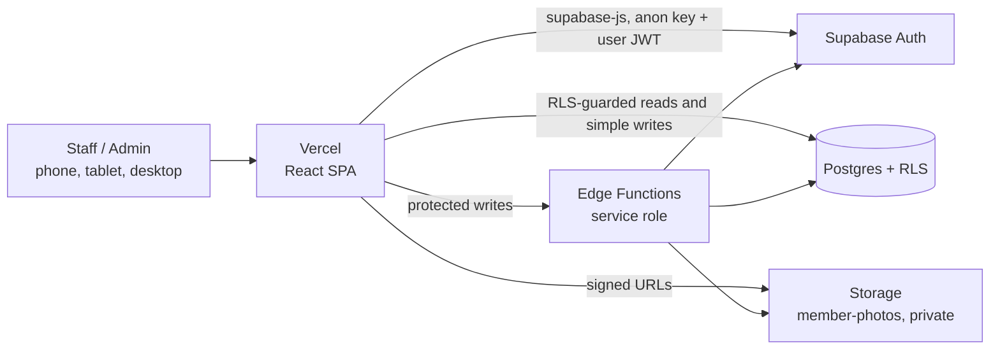
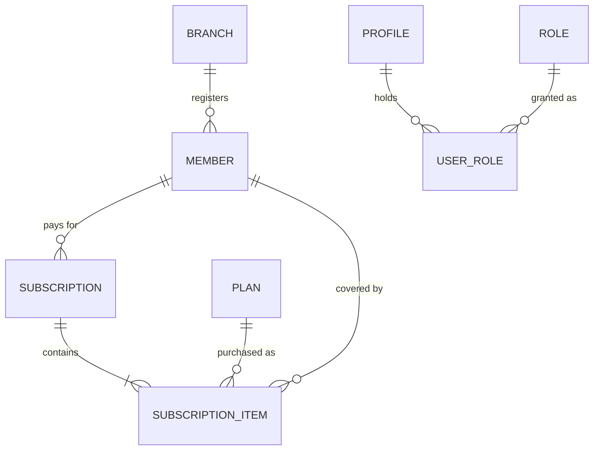

# Fit & Fine — Gym Subscription Manager

A web app for running a gym's front desk: members, membership plans and add-ons, branches, subscription checkouts and renewals, and reporting. Built with React + TypeScript on the frontend and Supabase (Postgres, Auth, Storage, Edge Functions) on the backend.

---

## Table of Contents

1. [Introduction](#1-introduction)
   - [What it does](#11-what-it-does)
   - [Design principles](#12-design-principles)
   - [Project status](#13-project-status)
2. [Tech Stack](#2-tech-stack)
3. [Repository Structure](#3-repository-structure)
4. [Development Environment Setup](#4-development-environment-setup)
   - [Prerequisites](#41-prerequisites)
   - [First-time setup](#42-first-time-setup)
   - [Everyday commands](#43-everyday-commands)
5. [Architecture and Design Patterns](#5-architecture-and-design-patterns)
   - [System context](#51-system-context)
   - [Layered client architecture](#52-layered-client-architecture)
   - [Server-side authority](#53-server-side-authority)
   - [Design patterns in use](#54-design-patterns-in-use)
   - [Data model](#55-data-model)
   - [Edge Function catalogue](#56-edge-function-catalogue)
   - [Core business rules](#57-core-business-rules)
6. [Quality Attributes](#6-quality-attributes)
7. [Development Standards](#7-development-standards)
8. [Testing](#8-testing)
   - [Strategy](#81-strategy)
   - [Testing standards](#82-testing-standards)
   - [Setup and commands](#83-setup-and-commands)
   - [What the suites do not cover](#84-what-the-suites-do-not-cover)
   - [Frontend coverage map](#85-frontend-coverage-map)
   - [Definition of done](#86-definition-of-done)
9. [Authentication, Roles and Permissions](#9-authentication-roles-and-permissions)
   - [Identity model](#91-identity-model)
   - [Sign-in methods](#92-sign-in-methods)
   - [Session lifecycle](#93-session-lifecycle)
   - [Password reset](#94-password-reset)
   - [Roles](#95-roles)
   - [Permission matrix](#96-permission-matrix)
   - [Route guards and navigation](#97-route-guards-and-navigation)
   - [Account safety rules](#98-account-safety-rules)
   - [Bootstrapping the first admin](#99-bootstrapping-the-first-admin)
10. [Deployment](#10-deployment)
    - [Environments and safety](#101-environments-and-safety)
    - [Deployment order](#102-deployment-order)
    - [Deploying Supabase](#103-deploying-supabase)
    - [Deploying the frontend to Vercel](#104-deploying-the-frontend-to-vercel)
    - [Post-deploy verification](#105-post-deploy-verification)
    - [Releasing changes](#106-releasing-changes)
    - [Configuration reference](#107-configuration-reference)
11. [Further Documentation](#11-further-documentation)

---

## 1. Introduction

### 1.1 What it does

Fit & Fine replaces paper registers and spreadsheets at a gym. Front-desk staff use it every day, mostly on a phone or tablet; admins use it to configure the catalogue and the team.

| Area | Capabilities |
|---|---|
| **Members** | Register members with photo (camera or upload, compressed in the browser), medical and emergency details; automatic per-branch member numbers; search and filter; soft delete |
| **Plans and subscriptions** | One catalogue of membership plans and add-ons; multi-item checkout with quantity multipliers; couple plans with a shared member; one-time (indefinite) items; renewals with an overlap warning |
| **Action Center** | A work queue of members whose subscriptions are expiring or have expired |
| **Reports** | Monthly membership and add-on counts, and an itemised transaction list |
| **Administration** | Users and invitations, roles, plans, branches, audit log, member-number sequences, Excel data export and import |
| **Responsive UI** | One layout switch at 768 px: bottom tab bar and cards on phones, sidebar and tables on tablet and desktop |

### 1.2 Design principles

- **The client is untrusted.** Anyone can call the Supabase REST API directly, so every security or data-integrity rule lives in Postgres (RLS, triggers, constraints) or an Edge Function. Client-side validation exists only for instant feedback.
- **Nothing is ever hard-deleted.** Business rows are soft-deleted (`deleted_at` / `deleted_by`), and a database trigger blocks real `DELETE`s. The single, deliberate exception is the system-admin-only permanent member purge.
- **Everything is accountable.** Audit columns are stamped by the database from `auth.uid()`, and a field-level audit log records every change.
- **The specs are the source of truth.** Behaviour is defined in [spec/](spec/) and binding engineering rules in [CLAUDE.md](CLAUDE.md); code follows them, not the other way round.

### 1.3 Project status

At the time of writing (see [TODO.md](TODO.md) for the live list):

| Feature | State |
|---|---|
| Members, plans, checkout and renewal, Action Center, reports, admin screens | Implemented |
| Excel data export (REQ-ADMIN-007) | Implemented |
| Permanent member delete and the reserved `system_admin` role (REQ-MEM-008, REQ-ADMIN-010) | Built; its migration and functions are not yet applied to a hosted project |
| Merge import (REQ-ADMIN-008) | Backend and screen built; the screen has no tests yet and the migration is not yet applied to a hosted project |
| Restore (REQ-ADMIN-009) | Specified only |
| Subscription cancellation and refund | Deferred by design |
| Server-side subscription overlap enforcement | Deliberately client-side only (REQ-SUB-005/008) |

---

## 2. Tech Stack

| Layer | Technology | Notes |
|---|---|---|
| **Frontend framework** | React 18, TypeScript 5 (strict), Vite 5 | Single-page app; every page except Login is a lazy chunk |
| **Routing** | React Router 6 | Data router with `v7_startTransition`; route `handle` metadata drives the tab bar |
| **Styling** | Plain per-page CSS + shared design tokens; Tailwind CSS 4 | Tailwind supplies the token theme and the `tablet:` / `desktop:` breakpoints. No UI component library (no MUI, Chakra, shadcn, Bootstrap) |
| **Icons and fonts** | `lucide-react`; Fontsource Rubik and Schibsted Grotesk | Fonts are self-hosted variable fonts |
| **Data transfer** | `write-excel-file`, `read-excel-file`, `fflate` | Loaded with dynamic `import()` only, so they never reach the main bundle |
| **Backend** | Supabase: Postgres 17, Row Level Security, Auth, Storage, Edge Functions | No custom server. Edge Functions are Deno 2 / TypeScript |
| **Client SDK** | `@supabase/supabase-js` 2 | Created in exactly one file: `frontend/src/lib/supabase-client.ts` |
| **Authentication** | Supabase Auth: email and password, Google OAuth | Invite-only for both |
| **File storage** | Supabase Storage, private `member-photos` bucket | Read through short-lived signed URLs |
| **Hosting** | Vercel (frontend), Supabase Cloud (database, auth, storage, functions) | |
| **Unit and component tests** | Vitest 3, React Testing Library, jsdom | |
| **End-to-end tests** | Playwright (Chromium and WebKit) | Supabase is mocked at the network layer |
| **Edge Function tests** | Deno test runner | `supabase-js` swapped for a scriptable fake |
| **Database tests** | SQL assertions on a throwaway Postgres | Runs the real migrations |
| **Tooling** | npm workspaces, Supabase CLI 2 (pinned as a dev dependency) | Use `npx supabase ...` |

---

## 3. Repository Structure

```
.
├── frontend/                     React + Vite SPA (the only npm workspace)
│   ├── src/
│   │   ├── pages/                Route-level screens (UI and local UI state only)
│   │   ├── components/           Shared UI: AppShell, route guards, nav, dialogs
│   │   ├── services/             Client-side validation and orchestration, one per entity
│   │   ├── repositories/         Supabase data access (queries and function invocations)
│   │   ├── context/              Auth, services (dependency injection) and theme providers
│   │   ├── lib/                  Supabase client, datetime, network-error, data-transfer, ...
│   │   ├── styles/               tokens.css (design tokens) and shared status styles
│   │   ├── types/                Database row types, named exactly like the columns
│   │   └── test/                 Test helpers: renderWithProviders, fakeServices, builders
│   ├── e2e/                      Playwright specs and the Supabase network mock
│   ├── vercel.json               SPA rewrite rules
│   └── .env.example              Template for frontend/.env.local
│
├── supabase/
│   ├── migrations/               Ordered SQL migrations (the only way the schema changes)
│   ├── functions/                Edge Functions, plus _tests/ (Deno)
│   ├── tests/                    SQL test suite and run.sh
│   ├── test-data/                Optional scripts and SQL for loading sample data
│   ├── seed.sql                  Fixture data, loaded by `supabase db reset` (local stack only)
│   └── config.toml               Supabase CLI config for the local stack
│
├── spec/                         Behaviour and architecture specs (source of truth)
├── CLAUDE.md                     Binding engineering rules (layers, responsive, testing)
├── TODO.md                       Open follow-ups and deployment debt
└── package.json                  Workspace root and top-level scripts
```

`design_handoff_*/` folders hold the original design hand-off material.

---

## 4. Development Environment Setup

### 4.1 Prerequisites

| Tool | Needed for | Notes |
|---|---|---|
| **Node.js 20 LTS or newer** and npm | Everything | The project is developed on Node 24 |
| **Git** | Everything | On Windows, Git Bash is also needed to run `npm run test:db` |
| **A Supabase project for development** | Running the app | Free tier is enough. Use a dedicated project, never production |
| **Supabase CLI** | Migrations and function deploys | Installed by `npm install`; run it as `npx supabase ...` |
| **Playwright browsers** | E2E tests | `npx playwright install chromium webkit`, once per machine |
| **Deno 2.x** | Edge Function tests | Optional if you use `npx -y deno` (see [8.3](#83-setup-and-commands)) |
| **PostgreSQL client and server** (`psql`, `createdb`, `dropdb`) | Database tests | Needs a superuser; on Windows put the PostgreSQL `bin` folder on `PATH` |
| **Docker** | `supabase start` (full local stack) | Optional. Day-to-day development does not need it |

### 4.2 First-time setup

1. **Install dependencies** (npm workspaces, from the repository root):
   ```bash
   npm install
   ```

2. **Create a development Supabase project** in the [Supabase dashboard](https://supabase.com/dashboard) and note its project ref.

3. **Apply the schema and deploy the functions** to that project by following [10.3 Deploying Supabase](#103-deploying-supabase). Target the development project explicitly (`--project-ref`); see [10.1](#101-environments-and-safety).

4. **Allow the dev server's URL for auth redirects.** In the Supabase dashboard open Authentication → URL Configuration and add `http://localhost:5173` to **Redirect URLs**. Without it, password-reset links and Google sign-in silently do nothing locally.

5. **Create your first admin** using [9.9 Bootstrapping the first admin](#99-bootstrapping-the-first-admin).

6. **Configure the frontend:**
   ```bash
   cp frontend/.env.example frontend/.env.local
   ```
   Fill in `VITE_SUPABASE_URL` and `VITE_SUPABASE_ANON_KEY` from Project Settings → API. Use the **anon** key only. The service role key must never appear in the frontend, in a `VITE_*` variable, or in any committed file. `frontend/.env.local` is gitignored.

7. **Start the dev server:**
   ```bash
   npm run dev:frontend
   ```
   The app is served at `http://localhost:5173`.

**Sample data.** `supabase/seed.sql` holds ten fixture members covering the active, expiring and expired states. It is loaded only by `supabase db reset` against the local Docker stack, never by `db push`. For a hosted development project, `supabase/test-data/` has helper scripts; read each one before you run it.

**Local stack (optional).** If you use `npx supabase start`, align `site_url` and `additional_redirect_urls` in `supabase/config.toml` with the URL you actually open (the checked-in values point at port 3000, while Vite uses 5173).

### 4.3 Everyday commands

From the repository root:

| Command | What it does |
|---|---|
| `npm run dev:frontend` | Vite dev server at `http://localhost:5173` |
| `npm run build:frontend` | `tsc --noEmit` then `vite build` |
| `npm run test:frontend` | Vitest unit and component tests |
| `npm run test:e2e:frontend` | Playwright E2E (builds and previews the app) |
| `npm run test:functions` | Deno tests for every Edge Function |
| `npm run test:db` | SQL tests against a throwaway Postgres |
| `npm test` | Frontend, functions and database suites (not E2E) |
| `npx supabase <command>` | Supabase CLI |

From `frontend/`: `npm run typecheck`, `npm run typecheck:e2e`, `npm run test:watch`, `npm run test:coverage`, `npm run test:e2e:ui`, `npm run preview`. There is no lint script in this repository.

---

## 5. Architecture and Design Patterns

### 5.1 System context



There is no application server. Simple reads and writes go straight from the browser to Postgres under RLS. Anything security-relevant goes through an Edge Function that re-checks the caller and then uses the service role.

### 5.2 Layered client architecture

```
┌─────────────────────────────────────────────────────────────┐
│ VIEW        pages/, components/                              │
│             UI and local UI state only. Reaches data through │
│             useServices() / useAuth() and nothing else.      │
└──────────────────────────────┬──────────────────────────────┘
                               │ calls
┌──────────────────────────────▼──────────────────────────────┐
│ SERVICE     services/                                        │
│             Client-side validation and orchestration. Depends│
│             on repository interfaces, never implementations. │
└──────────────────────────────┬──────────────────────────────┘
                               │ calls
┌──────────────────────────────▼──────────────────────────────┐
│ REPOSITORY  repositories/                                    │
│             Data access only: typed supabase-js queries or   │
│             supabase.functions.invoke. No business logic.    │
└──────────────────────────────┬──────────────────────────────┘
                               │
┌──────────────────────────────▼──────────────────────────────┐
│ SUPABASE    Postgres + RLS (data-access authority)           │
│             Edge Functions (business-rule authority)         │
└─────────────────────────────────────────────────────────────┘
```

| Rule | Why |
|---|---|
| A page or component never imports `supabase-js` and never calls `supabase.functions.invoke` | Keeps the data path in one place and lets tests swap it |
| A service never imports a concrete repository, nor anything from `pages/` or `components/` | Services stay testable and UI-agnostic |
| A repository contains no business logic and no date math | It is a thin, typed adapter over Supabase |
| A `lib/` hook or helper that needs data receives it via `useServices()` or an argument, never by importing a repository singleton | Tests can inject fakes |

### 5.3 Server-side authority

| Rule | Server-side mechanism |
|---|---|
| `end_date` = `start_date + duration_days × quantity − 1` (null if indefinite) | `create-subscription` Edge Function, per item |
| Subscription overlap warning | **Client-side only, by design.** No backend enforcement exists |
| Plan, branch and role deletion guards | `delete-plan`, `delete-branch`, `delete-role` functions plus `ON DELETE RESTRICT` |
| Audit fields (`created_by`, `changed_by`, `deleted_by`) | Postgres trigger reads `auth.uid()`; the client never sets them |
| Soft delete only | `deleted_at` / `deleted_by` pattern, backstopped by a `prevent_hard_delete()` trigger |
| Permanent member delete | `purge-member` function and a service-role-only `purge_member()`; system admins only |
| Role-based access | RLS policies (primary) plus route guards (UX only) |
| User invitation | `invite-user` function using the service role |
| Reserved `system_admin` role | Trigger on `roles`, guards in `replace_user_roles`, `invite-user` and `delete-role` |

### 5.4 Design patterns in use

| Pattern | Where | Purpose |
|---|---|---|
| **Layered architecture** (View, Service, Repository) | `frontend/src/` | Separation of concerns and a single data path |
| **Repository pattern** | `repositories/` | Isolates Supabase specifics behind typed interfaces |
| **Dependency injection via React Context** | `ServicesProvider`, `useServices()` | Services and repositories are wired in one place; tests pass fakes |
| **Secured command endpoints** | `supabase/functions/*` | Writes that carry business rules run server-side with the service role after re-checking the caller's JWT |
| **Transactional RPC** | `create_subscription_with_items`, `import_workbook`, `purge_member` | A multi-row write lands entirely or not at all |
| **Append-only line items** | `subscription_items` | Items are immutable after checkout; changes mean a new checkout |
| **Soft delete plus trigger-enforced audit trail** | Every business table | Reversible deletes and full accountability |
| **Configuration table** | `configuration` | Operational constants (member-number start, increment, padding) are data, not code |
| **Route guards and route metadata** | `RequireAuth`, `RequireAdmin`, `handle: { hideTabBar }` | Access UX and layout decisions are declared on the route, not path-matched in components |
| **Single-render responsive branching** | `useIsTabletUp()` | Exactly one of table or cards is mounted; no hidden twin |
| **Code splitting with an error boundary** | `React.lazy`, `Suspense`, `ChunkLoadErrorBoundary` | Small first load; a stale chunk after a redeploy fails gracefully |
| **Single source of truth modules** | `nav-items.tsx`, `workbook-schema.ts`, `supabase-client.ts`, `tokens.css` | One place to change a nav item, a sheet column, the Supabase client or a design token |

### 5.5 Data model



| Object | Purpose |
|---|---|
| `profiles` | App data for each user, 1:1 with `auth.users` (name, active flag). Email and credentials stay in Supabase Auth |
| `roles`, `user_roles` | Admin-managed role catalogue and a many-to-many grant table. Written only through `replace_user_roles()` |
| `branches` | Gym locations. The branch code prefixes member numbers |
| `plans` | Unified catalogue of memberships and add-ons (`category`), with `duration_days` (null means indefinite), `price` and `max_members` (2 for couple plans) |
| `members` | Member records, including the system-generated `member_number` and photo paths |
| `member_number_sequences` | One continuous counter per branch, never reset |
| `subscriptions` | A thin header per checkout: member, payment mode, notes |
| `subscription_items` | One row per plan in a checkout: dates, quantity, amount paid, optional shared member |
| `audit_log` | Field-level change history, written only by a database trigger |
| `configuration` | Key/value operational settings |
| Views | `profiles_with_roles`, `member_current_items`, `member_list_view` |
| Storage | Private `member-photos` bucket (5 MB limit; JPEG, PNG, WebP) |

Full schema, triggers and policies: [spec/backend/database.md](spec/backend/database.md).

### 5.6 Edge Function catalogue

All functions re-validate the caller from the request JWT before doing anything privileged. "Active user" means a non-deactivated, non-deleted profile with any role.

| Function | Who may call | Purpose |
|---|---|---|
| `create-subscription` | Active user | Validates a checkout, computes each `end_date`, blocks a repeat indefinite item, inserts the header and all items in one transaction |
| `update-subscription` | Active user | Edits header fields only (`payment_mode`, `notes`) |
| `delete-member` | Active user | Soft-deletes a member unless live subscription items reference them |
| `purge-member` | System admin | Permanently erases a member, their subscriptions, audit rows and photos |
| `delete-plan`, `delete-branch` | Admin | Usage guard, then soft delete |
| `delete-role` | Admin | Usage guard, then soft delete; refuses the reserved `system_admin` role |
| `invite-user` | Admin | Invites by email and assigns roles; only a system admin may grant `system_admin` |
| `list-users` | Admin | Lists users with their emails (needs the Admin API) |
| `update-user` | Admin | Edits name, roles, active flag, or soft-deletes a user; protects against self-change and last-admin lockout |
| `update-member-number-sequence` | Admin | Retargets a branch's member-number counter safely |
| `export-data` | Admin | Paged read of whitelisted tables, including soft-deleted rows, for the Excel export |
| `import-data` | Admin | Merge-mode import: validates the workbook and runs one atomic RPC (dry run supported) |

Reports need no function: they are RLS-guarded reads available to every active user. Full contracts: [spec/backend/edge-functions.md](spec/backend/edge-functions.md).

### 5.7 Core business rules

- **One membership per checkout.** A checkout holds exactly one `membership` item plus any number of `addon` items.
- **End date.** `start_date + (duration_days × quantity) − 1`, computed server-side. Indefinite plans (`duration_days` null) have no end date.
- **Indefinite items are once-only.** A member cannot be given the same indefinite item twice; this is a hard block with no override.
- **Couple plans.** A `max_members = 2` plan may name a second, distinct member on its membership item.
- **Overlap warning.** The checkout form warns about overlapping dates before calling the function. It is a UX safety net, not a control.
- **Member numbers.** Generated by the database per branch, continuous for the branch's lifetime, never reused. The client never supplies one.
- **Phone numbers** are unique among live (not soft-deleted) members.
- **Dates.** Calendar dates are `YYYY-MM-DD` Postgres `date` values; timestamps are UTC `timestamptz`, converted to local time only for display.

Details: [spec/backend/business-logic.md](spec/backend/business-logic.md).

---

## 6. Quality Attributes

| Attribute | What we require | How it is achieved | Verified by |
|---|---|---|---|
| **Security** | A hostile client cannot read or change what it should not | RLS on every table; service role key only in Edge Functions; each function re-checks JWT and role; invite-only sign-in; column-level grant limits self-edits on `profiles` to `full_name`; privileged RPCs revoked from `public, anon, authenticated`; private photo bucket with signed URLs | SQL tests (RLS, grants, triggers), Edge Function tests |
| **Data integrity** | No orphaned, partial or silently altered records | Soft delete with `prevent_hard_delete()`; `CHECK`, `UNIQUE` and `RESTRICT` constraints; atomic RPCs for multi-row writes; immutable line items | SQL tests, including a concurrency test |
| **Auditability** | Every change is attributable | Audit columns stamped from `auth.uid()` by trigger; field-level `audit_log` written only by trigger and readable only by admins | SQL tests |
| **Reliability and resilience** | The app fails clearly and recovers | Offline detection via `isNetworkError()` (not message matching); every data screen has loading, error and retry states; profile lookup times out after 10 s; a 401 anywhere returns the user to Login; sessions are re-checked when a tab regains focus; stale lazy chunks are caught by `ChunkLoadErrorBoundary` | Unit and E2E tests (offline, dead token, navigation race) |
| **Performance** | Fast first load; member list under 1 s at roughly 2,000 members | Route-level code splitting; React and Supabase vendor chunks; Excel and zip libraries loaded on demand; one render branch per breakpoint; keyset-paged export; audit log capped at 500 rows per query | Production build chunk output; `supabase/tests/60_performance.test.sql` (database side of the budget) |
| **Usability and responsiveness** | Front desk can work one-handed on a phone | One breakpoint (768 px); bottom tab bar on phones, sidebar on larger screens; drill-in screens show a back link; 16 px form controls (no iOS zoom); `100dvh` shells and safe-area insets | E2E in desktop and mobile projects |
| **Accessibility** | Usable by touch, keyboard and assistive tech | Touch targets of at least 44 × 44 px; status never conveyed by colour alone; tests query by role, label and visible text; dialogs manage focus | Component and E2E tests |
| **Maintainability** | Safe to change without surprises | Strict layering; strict TypeScript with no `any`; types named after columns; migrations only for schema; one source of truth per concern; specs kept in step with code | Typecheck in the build; spec traceability matrix |
| **Testability** | Every layer can be tested in isolation | Dependency injection through `useServices()`; `fakeServices` throws on any un-faked method; Supabase mocked at the network layer in E2E | The four test suites |
| **Compatibility** | Works on current phones and desktops | E2E runs on Desktop Chrome, Pixel 7 (Chromium) and iPhone 13 (WebKit). iOS Safari specifics still need a manual check on a preview deployment | Playwright projects |

---

## 7. Development Standards

Binding rules live in [CLAUDE.md](CLAUDE.md), [spec/backend/rules.md](spec/backend/rules.md) and [spec/frontend/rules.md](spec/frontend/rules.md). Read the relevant spec before writing a new service, repository or Edge Function, and update the spec in the same change when behaviour changes.

### 7.1 Code

- **TypeScript strict, no `any`.** Row types in `frontend/src/types/` match column names exactly, including `deleted_at` / `deleted_by`.
- **Respect the layers** ([5.2](#52-layered-client-architecture)). Components reach data only via `useServices()` or `useAuth()`.
- **Never set audit columns from the client.** Omit `created_at`, `created_by`, `changed_at`, `changed_by`, `deleted_at` and `deleted_by` from insert and update payloads.
- **No hard `DELETE`.** Use the soft-delete update pattern. A change that adds `.delete()` or `DELETE FROM` on a business table is rejected in review.
- **Dates** go through `frontend/src/lib/datetime.ts`. Never compute or trust a client-supplied `end_date`.
- **Offline detection** uses `isNetworkError()` from `lib/network-error.ts`, never a comparison against a message such as `'Failed to fetch'`.
- **Operational constants** belong in the `configuration` table, not in code.
- **Data-transfer libraries** (`write-excel-file`, `fflate`, `read-excel-file`) are loaded with dynamic `import()` only.

### 7.2 Styling and UI

- No third-party UI component libraries. `lucide-react` is the one approved icon set.
- No hex colour literals outside `frontend/src/styles/tokens.css`; fonts only via `var(--font-ui)` and `var(--font-display)`.
- `.status-badge-*` styles live in one shared stylesheet and are never re-declared in a page's CSS.
- Touch targets are at least 44 × 44 px; no hover-only information; status is never colour alone.
- Full-height shells use `100dvh` with a `100vh` fallback; safe areas come from `env(safe-area-inset-*)`.

### 7.3 Responsive rendering

The whole app switches at **one** breakpoint: `768px`.

| Mechanism | Use it for | Never for |
|---|---|---|
| `useIsTabletUp()` (`matchMedia` on `(min-width: 768px)`) | Alternate renderings of the same content: sidebar vs tab bar, table vs card list | Spacing, columns, font sizes |
| CSS media queries or Tailwind `tablet:` / `desktop:` | Pure styling differences on identical markup | Hiding a second, fully rendered copy of a component |

1. **Never mount both versions and hide one with CSS.** Hidden copies still run hooks and effects and fetch images twice.
2. JS and CSS gates use the same pixel query. Never feed the rem-based Tailwind token into JavaScript.
3. A hook that fetches data (such as the Action Center count) is called once in an always-mounted component (`AppShell`) and passed down as props.
4. Tab-bar visibility is route data (`handle: { hideTabBar: true }`), never path matching in components.
5. Page state (search, filters, form input) lives above any breakpoint-switched branch so rotating a phone loses nothing.
6. z-index scale: tab bar 10, mobile header 20, filter drawer 40, modals 50, camera modal 60, photo lightbox 70. A new fixed layer takes a slot in this scale.
7. Every page is a lazy chunk and `RouterProvider` keeps `future={{ v7_startTransition: true }}`; removing it breaks Back navigation during a chunk load.

### 7.4 Database and Edge Functions

- **Schema changes only through `supabase/migrations/`.** Never edit an applied migration; add a new one. Never hand-edit the hosted schema.
- **RLS is enabled on every table.** A table with RLS and no matching policy denies by default, which is the safe failure.
- **Every Edge Function verifies the caller's identity and role from the JWT first.**
- **Service-role reads must filter `deleted_at is null` explicitly**, because RLS does not apply to them. The only exceptions are `export-data` (a complete record) and `purge-member` (it must see soft-deleted members).
- **Any new service-role RPC or internal table must `revoke ... from public, anon, authenticated` explicitly.** The older `revoke ... from public` pattern leaves it callable by signed-in users.
- Only one permanent-delete path exists (`purge-member` / `purge_member()`). Do not add a second.

### 7.5 Working agreement

- Keep changes small and focused; every change ships with its tests ([8.2](#82-testing-standards)).
- Keep `README.md`, `CLAUDE.md` and the relevant spec files accurate when you change behaviour, commands or structure.
- Do not commit secrets or `.env.local` files. Only the anon key ever ships to a browser.

---

## 8. Testing

### 8.1 Strategy

Four dev-only suites (nothing here ships to the browser), each aimed at the layer it can verify best:

| Suite | Tool | Scope | Command (repo root) |
|---|---|---|---|
| **Unit and component** | Vitest, React Testing Library, jsdom | `lib/` helpers, services, contexts, components, pages, route table, repositories' request shapes | `npm run test:frontend` |
| **End-to-end** | Playwright on a production build | User flows in real browsers and real CSS, in three projects | `npm run test:e2e:frontend` |
| **Edge Functions** | Deno test runner | Auth gates, validation, guards and payload shaping for every function | `npm run test:functions` |
| **Database** | SQL assertions on a throwaway Postgres | Schema, constraints, triggers, RLS, RPCs, views, audit log, concurrency, a 2,000-member load check | `npm run test:db` |

`npm test` runs the frontend, function and database suites. E2E is excluded because it builds the app and is slower. The requirement-by-requirement map for the server-side suites is [spec/test-traceability.md](spec/test-traceability.md).

### 8.2 Testing standards

These rules are binding (full text in [CLAUDE.md](CLAUDE.md#testing-rules-binding)):

1. Every new or changed component, page, hook, service or `lib/` helper ships a test in the same change. Every user-facing flow or route change also gets Playwright coverage that passes in both a desktop and a mobile project.
2. A screen with alternate renderings asserts that **exactly one** is in the DOM at each width (zero `<table>` at 390 px; no card list at 1024 px).
3. Unit tests never touch Supabase. Pages and components get fakes through `renderWithProviders(ui, { services: fakeServices({...}), auth: {...} })` from `frontend/src/test/`. A fake method a test did not set up throws a named error instead of silently succeeding. A service test replaces its repository module with `vi.mock` and a typed fake.
4. E2E runs against the **production build** with Supabase's network mocked by `frontend/e2e/fixtures/supabase-mock.ts`. Any unmocked request fails the test. No real Supabase project and no service role key appear in any test, fixture or env file.
5. Query by role, label and visible text, not class names or implementation details. The exception is the single-rendering assertions, which count elements.
6. A failing test is fixed, or deleted with a stated reason. Never commit `.skip` or `.only`.
7. Server-side tests for behaviour the spec requires but the code does not yet deliver are kept, not skipped, and marked `GAP`. They pass while the gap exists and fail once it is fixed, so they must then be promoted to normal tests.
8. Report failures verbatim. Never claim a pass that was not run.

### 8.3 Setup and commands

**Frontend unit and component tests**

```bash
npm run test:frontend         # from the root; single run
cd frontend
npm run test:watch            # watch mode
npm run test:coverage         # v8 coverage report (informational, no threshold)
npm run typecheck             # app and colocated tests
npm run typecheck:e2e         # Playwright does not typecheck specs, so this does
```

Tests sit next to the code as `*.test.ts(x)`. Vitest supplies dummy `VITE_SUPABASE_*` values, so no `.env.local` is needed.

**End-to-end tests**

```bash
npx playwright install chromium webkit   # once per machine
npm run test:e2e:frontend                # builds, previews, runs all three projects
cd frontend && npm run test:e2e:ui       # Playwright UI mode, for debugging a spec
```

Projects: `desktop-chrome`, `mobile-chrome` (Pixel 7), `mobile-safari` (iPhone 13, WebKit). The run builds the app first, so allow a few minutes. It runs against `vite preview` rather than the dev server because React StrictMode double-runs effects in dev, which would corrupt the render-once and request-count assertions. Specs assert the requests the client sends; those payloads are the contract with the database and the functions.

**Edge Function tests**

```bash
npm run test:functions
```

This needs Deno 2.x on `PATH`. Without a global install, run the same command through npx:

```bash
npx -y deno test --import-map=supabase/functions/_tests/import_map.json --allow-env --allow-read supabase/functions/_tests/
```

The import map swaps `@supabase/supabase-js` for the scriptable fake in `supabase/functions/_tests/fake-supabase.ts`.

**Database tests**

```bash
npm run test:db
```

`supabase/tests/run.sh` creates a throwaway database (`gym_subscription_test`, override with `TEST_DB`), stubs Supabase's `auth`, `storage` and roles, applies every real migration, runs each `*.test.sql`, runs the concurrency script, and drops the database. Requirements:

- `psql`, `createdb` and `dropdb` on `PATH`, and `bash` (Git Bash on Windows).
- A reachable Postgres superuser, selected with the standard `PGHOST`, `PGPORT` and `PGUSER` variables. Supply the password through `PGPASSWORD` or a `pgpass` file (`%APPDATA%\postgresql\pgpass.conf` on Windows), never on the command line.
- Prefer a disposable local cluster over a shared server. The script drops and creates databases.

### 8.4 What the suites do not cover

- **RLS, triggers and Edge Function code** are not exercised by the frontend suites; the E2E mock fakes the server's *answers*. The Deno and database suites verify the real behaviour. A run against a real local Supabase stack is a planned follow-up.
- **Pixel-level visuals.** `e2e/screens-visual.spec.ts` only produces screenshots for review.
- **iOS Safari specifics** (safe areas, focus zoom, address-bar behaviour). Playwright WebKit does not reproduce them, so check a Vercel preview on a real phone.
- **Google OAuth** is unit-tested only.

### 8.5 Frontend coverage map

| Area | Where | How it is tested |
|---|---|---|
| `lib/` helpers | `src/lib/*.test.ts(x)` | One unit test file per helper |
| Services | `src/services/*.test.ts` | Against fake repositories: validation and orchestration |
| Contexts (auth, services, theme) | `src/context/*.test.tsx` | Provider behaviour, storage keys, session lifecycle |
| Components | `src/components/*.test.tsx` | RTL; shell and nav assert exactly one navigation structure at 390, 767, 768 and 1024 px |
| Pages | `src/pages/*.test.tsx` | RTL with fake services: loading, success, empty, error and retry; role gating; key interactions; list pages assert exactly one of table or cards |
| Route table | `src/App.test.tsx` | The documented route set, guards, `hideTabBar` handles |
| Repositories | `src/repositories/*.test.ts` | Request shapes against a mocked supabase-js |
| Shell, theme, scroll, overflow, render-once | `e2e/shell-responsive`, `theme`, `scroll`, `mobile-conventions`, `lists-render-once` | Real browsers and CSS, three projects |
| Sign-in, access, deep links | `e2e/smoke`, `auth` | Wrong password, deactivated and never-invited accounts, forgot password, a dead token mid-session, refresh on a deep URL |
| Members | `e2e/members` | List search, filter and open; create, edit and delete payloads; phone layout |
| Renew checkout | `e2e/renew` | The exact `create-subscription` body, overlap warning, offline retry |
| Action Center | `e2e/action-center` | Queue window, tabs, badge, carousel, photo lightbox |
| Reports | `e2e/reports` | Range presets as database filters, table vs cards, independent retry |
| Admin: Settings, Plans, Branches, Roles | `e2e/settings-admin` | Hub counts, role gating, CRUD payloads, delete guards |
| Admin: Users, Invite | `e2e/admin-users` | Function payloads, self-protection, soft delete and restore |
| Admin: Audit Log, Member Numbering | `e2e/admin-audit-numbering` | Filters as requests, view-only, atomic settings RPC |
| Admin: Data Backup | `e2e/data-backup` | Export with and without audit log and photos, cancel, offline retry, server refusal, admin-only access |
| Navigation under a slow connection | `e2e/navigation-race` | Back pressed while the next lazy screen is still loading |
| Fonts | `e2e/fonts` | Only the Latin subsets download |
| Phone screens for review | `e2e/screens-visual` | Screenshots attached to the report (not a gate) |

### 8.6 Definition of done

Before calling work finished, run and report the real result of:

```bash
npm run test:frontend
npm run build:frontend
npm run test:e2e:frontend     # whenever a route, flow or layout changed
npm run test:functions        # whenever an Edge Function changed
npm run test:db               # whenever a migration changed
```

---

## 9. Authentication, Roles and Permissions

### 9.1 Identity model

- **Supabase Auth owns identity.** Email, password hash and OAuth identities live in `auth.users` and are never copied into app tables. A screen that needs the signed-in user's email reads it from the session.
- **`profiles` is the app's user record**, 1:1 with `auth.users` (same `id`): `full_name`, `is_active`, audit and soft-delete columns. It has no `ON DELETE CASCADE`, so deleting an auth user directly fails rather than cascading into a hard delete.
- **A profile is created only by invitation.** The `invite-user` function creates the auth user; the `handle_new_auth_user()` trigger creates the matching profile. Nothing else creates one.
- **Roles are rows, not a column.** `roles` plus `user_roles` let a user hold several roles. Because ordinary users have no write grant on `user_roles`, a user cannot promote themselves.

### 9.2 Sign-in methods

| Method | Behaviour |
|---|---|
| **Email and password** | `supabase.auth.signInWithPassword`. A failure always shows a generic "invalid email or password" and never reveals whether the email exists |
| **Google OAuth** | `supabase.auth.signInWithOAuth('google')`. Supabase links it to the same account by email, so one person has one account with two interchangeable ways in |

**Both methods are invite-only.** Supabase Auth would happily create a session for any Google account, so the app enforces the rule itself. After every sign-in, `AuthProvider` looks up the profile. If none exists it signs the session out immediately and shows "This email hasn't been invited — contact your admin." A deactivated profile is signed out with its own message. A successful OAuth handshake alone never grants access.

### 9.3 Session lifecycle

Implemented in `frontend/src/context/auth.context.tsx`:

1. On load, read the session with `getSession()` and fetch the matching profile (10 s timeout, one 500 ms retry to absorb the invite-trigger race).
2. If the profile is missing or deactivated, sign out and show the reason. If the lookup fails for a network or backend reason, withhold access with a "couldn't verify your account" message instead of wrongly reporting "not invited".
3. `supabase-js` refreshes the access token in the background.
4. When a tab becomes visible again, the session and profile are re-checked, so an account deactivated while the tab was hidden is caught on return.
5. Any 401 from REST, RPC, Storage or an Edge Function raises a session-expired event; the user lands on Login with an explanatory message.
6. RLS gates every table on an active, non-deleted profile, so a deactivated account loses access on its next request even while its token is still technically valid.

### 9.4 Password reset

- Reset runs entirely in Supabase Auth: `resetPasswordForEmail`, then `updateUser({ password })` after following the emailed link. No Edge Function is involved.
- The confirmation text is generic ("if that email is registered, a reset link has been sent") whether or not an account exists.
- The link creates a real session through a `PASSWORD_RECOVERY` event. The app routes that session to `/reset-password`, a bare screen outside the app shell, and does nothing else until a new password is set.
- A Google-only user can use the same flow to set a password for the first time.
- **`redirectTo` must be allow-listed.** Supabase validates it against Authentication → URL Configuration → Redirect URLs. If the URL is not listed, no token is attached and the user lands on the Site URL with no session and no error. Add every real deployment origin there; `config.toml` configures only the local stack.

### 9.5 Roles

| Role | Meaning | Notes |
|---|---|---|
| **Staff** | Day-to-day work: members, checkouts, reports | Not a special database rule. Any active user who is not an admin has this level of access |
| **`admin`** | Staff access plus everything under Settings | Seeded. Checked by `is_admin_user()` in RLS and in every admin Edge Function |
| **`system_admin`** | An admin who can also permanently delete a member and grant or remove this role | Reserved and seeded. Held on top of `admin` (`is_system_admin_user()` requires both). Cannot be created, renamed, edited or deleted from the app |

Admins can add further roles in **Manage Roles**, but only `admin` and `system_admin` carry built-in behaviour. Every other role grants the same access as staff and acts as a label.

### 9.6 Permission matrix

Authority is the database or function named in the last column. The UI hides what a role cannot use, but that is convenience only.

| Capability | Staff | Admin | System admin | Enforced by |
|---|:---:|:---:|:---:|---|
| Sign in; use Action Center, Members, Reports | ✅ | ✅ | ✅ | RLS on `is_active_user()` |
| Add and edit members, upload photos | ✅ | ✅ | ✅ | RLS `members_*_active_users`; storage policies |
| Soft-delete a member (blocked if it has subscription items) | ✅ | ✅ | ✅ | `delete-member` |
| Create a checkout; edit a subscription's header | ✅ | ✅ | ✅ | `create-subscription`, `update-subscription` |
| Create, edit and delete plans and branches | — | ✅ | ✅ | RLS plus `delete-plan`, `delete-branch` |
| Manage the role catalogue | — | ✅ | ✅ | RLS plus `delete-role` |
| Invite, edit, deactivate and delete users; assign roles | — | ✅ | ✅ | `invite-user`, `list-users`, `update-user` |
| View the audit log | — | ✅ | ✅ | RLS `audit_log_select_admin` |
| Configure member numbering | — | ✅ | ✅ | RLS plus `update-member-number-sequence` |
| Export and import data | — | ✅ | ✅ | `export-data`, `import-data` |
| Grant or remove the `system_admin` role | — | — | ✅ | `replace_user_roles`, `invite-user` |
| Permanently delete a member | — | — | ✅ | `purge-member` and `purge_member()` |

### 9.7 Route guards and navigation

| Guard | Applies to | Behaviour |
|---|---|---|
| `RequireAuth` | Everything except `/login` and `/reset-password` | Redirects to Login when there is no active profile |
| `RequireAdmin` | `/settings`, `/plans`, `/branches`, `/users`, `/users/invite`, `/roles`, `/audit-log`, `/member-numbering`, `/data-backup` | Shows "Access denied" unless the profile holds `admin` |

Navigation is filtered from one list (`components/nav-items.tsx`): staff see Action Center, Members and Reports; admins also see Settings. The permanent-delete button appears only when `isSystemAdmin(roles)` is true. All of this is user-experience only; a direct API call is stopped by RLS and the functions.

### 9.8 Account safety rules

- An admin cannot change their **own** roles or active flag, or delete their own account, through `update-user`. Editing their own name is allowed.
- **Last-admin lockout.** Removing the admin role from, deactivating, or soft-deleting the last active admin is refused, whoever performs it.
- **Deactivation** is a reversible toggle (`is_active`). **Deletion** is a soft delete that hides the account from User Management. They are independent.
- Only a system admin can grant or remove `system_admin`. Editing a system admin's other roles is fine while `system_admin` stays in the list.
- `user_roles` has no client write path. Every role change goes through `replace_user_roles()` (service role only).

### 9.9 Bootstrapping the first admin

A new Supabase project has no users, and seeding a well-known admin credential would be a security hole, so the first admin is created once, by hand, by whoever sets up the project. Run this **once per Supabase project**, after the migrations have been applied:

1. In the Supabase dashboard open Authentication → Users → **Invite user** (or **Add user**) with the admin's real email. If you create the user through the Admin API instead, pass `raw_user_meta_data = { "full_name": "..." }` so the trigger creates the profile with the right name.
2. Copy the new user's id and grant the admin role in the SQL editor:
   ```sql
   insert into user_roles (user_id, role_id)
   select '<the new auth.users.id>', id from roles where name = 'admin';
   ```
3. Sign in. From now on, create every other user through **Settings → Users → Invite**.

**First system admin.** Only a system admin can grant `system_admin`, so the first one is also granted by hand. The user must already hold `admin`, and the migration that seeds the role (`20261008000000`) must be applied:

```sql
insert into user_roles (user_id, role_id)
select '<that user''s auth.users.id>', id from roles where name = 'system_admin' and deleted_at is null;
```

Until someone holds it, nobody sees the permanent-delete button.

---

## 10. Deployment

### 10.1 Environments and safety

Run at least two separate environments, each with its own Supabase project and its own Vercel environment variables:

| Environment | Supabase project | Frontend |
|---|---|---|
| Development and test | A dedicated, disposable project | `frontend/.env.local`, and Vercel Preview if used |
| Production | The live project with real member data | Vercel Production |

**Know which project the CLI is pointed at.** `supabase link` stores a project ref locally, and every later `db push`, `functions deploy` and `secrets set` acts on that project. A mistaken command against production can alter real member data.

- Check the link before you push: `npx supabase projects list` marks the linked project.
- Prefer explicit targets over relying on the link: `--project-ref <ref>` on `functions deploy` and `secrets set`, and `--db-url <url>` on `db push`.
- Run `npx supabase db push --dry-run` first to see which migrations would apply.
- Features that write data in bulk (Merge import, and Restore once built) should be exercised on the development project first.
- Keep secrets for each environment in gitignored local files or the platform's secret store, never in the repository, a chat or a command line.

### 10.2 Deployment order

Deploy in this order so a newer frontend never calls a server piece that does not exist yet:

1. **Database:** apply migrations.
2. **Edge Functions:** deploy all functions.
3. **Supabase Auth configuration:** URLs, Google provider, email.
4. **First admin:** bootstrap once per project ([9.9](#99-bootstrapping-the-first-admin)).
5. **Frontend:** deploy to Vercel.
6. **Back to Supabase:** add the final Vercel domain to the redirect allow-list.
7. **Verify** ([10.5](#105-post-deploy-verification)).

### 10.3 Deploying Supabase

Run from the repository root.

**1. Link the CLI** to the target project. Find the ref in the dashboard URL or under Project Settings → General.

```bash
npx supabase login
npx supabase link --project-ref YOUR_PROJECT_REF
```

**2. Apply the schema.**

```bash
npx supabase db push --dry-run     # preview
npx supabase db push               # applies supabase/migrations/ in order
```

Migrations also create the private `member-photos` storage bucket and its policies, and seed the `admin`, `staff` and `system_admin` roles, one branch and a starter plan catalogue.

**3. Deploy every Edge Function.**

```bash
for fn in create-subscription update-subscription delete-member purge-member \
          delete-plan delete-branch delete-role invite-user list-users update-user \
          update-member-number-sequence export-data import-data; do
  npx supabase functions deploy "$fn"
done
```

PowerShell:

```powershell
$functions = 'create-subscription','update-subscription','delete-member','purge-member',
             'delete-plan','delete-branch','delete-role','invite-user','list-users','update-user',
             'update-member-number-sequence','export-data','import-data'
foreach ($fn in $functions) { npx supabase functions deploy $fn }
```

Redeploy only the functions you changed on later releases.

**4. Secrets.** `SUPABASE_URL`, `SUPABASE_ANON_KEY` and `SUPABASE_SERVICE_ROLE_KEY` are provided to Edge Functions automatically; the functions need nothing else. Set extra secrets (for example SMTP credentials referenced from `config.toml`) with:

```bash
npx supabase secrets set SOME_SECRET=value
```

Never copy the service role key into frontend code, a `VITE_*` variable or a committed file.

**5. Authentication settings** (dashboard, Authentication):

| Setting | Value |
|---|---|
| URL Configuration → **Site URL** | Your production domain |
| URL Configuration → **Redirect URLs** | Production domain, `http://localhost:5173` for development, and any Vercel preview domains (wildcards are allowed). The app sends the bare origin as `redirectTo`, so the bare origin must be listed |
| Providers → **Google** | Create an OAuth client in Google Cloud Console, add `https://<project-ref>.supabase.co/auth/v1/callback` as an authorized redirect URI, then paste the client ID and secret into the dashboard |
| Email | Supabase's built-in sender is meant for testing and is rate-limited. Configure custom SMTP before inviting real users |

`supabase/config.toml` configures only the local stack and is **not** synced to a hosted project. Every one of these settings must be made in the dashboard.

**6. Bootstrap the first admin** as described in [9.9](#99-bootstrapping-the-first-admin).

### 10.4 Deploying the frontend to Vercel

1. Push the repository to GitHub (or GitLab or Bitbucket).
2. In Vercel choose **Add New Project** and import the repository.
3. Configure the project:

   | Setting | Value |
   |---|---|
   | Root Directory | `frontend` |
   | Framework Preset | Vite |
   | Build Command | `npm run build` (runs `tsc --noEmit && vite build`) |
   | Output Directory | `dist` |
   | Node.js version | 20.x or newer |

4. Add environment variables (Project Settings → Environment Variables) for Production, Preview and Development as needed:

   | Name | Value |
   |---|---|
   | `VITE_SUPABASE_URL` | The project's URL for that environment |
   | `VITE_SUPABASE_ANON_KEY` | The project's anon key for that environment |

   Never add the service role key to Vercel. It exists only as an Edge Function secret.

5. Deploy, then add the resulting domain (and any preview domain pattern) to the Supabase redirect allow-list ([10.3 step 5](#103-deploying-supabase)).

**Routing.** `frontend/vercel.json` rewrites every path except `/assets/*` to `index.html`, so refreshing or opening a deep link such as `/members/123` loads the SPA instead of a 404. `/assets/*` is excluded on purpose: a stale chunk from an earlier deploy must still return 404 so `ChunkLoadErrorBoundary` can catch it and prompt a reload.

### 10.5 Post-deploy verification

- [ ] Sign in with the bootstrap admin; the Members list loads.
- [ ] Invite a staff user; the email arrives and the invited user can sign in.
- [ ] A staff user cannot open `/settings` (Access denied), and Settings is absent from their navigation.
- [ ] Sign in with Google using an **uninvited** account: access is refused with the "hasn't been invited" message.
- [ ] Password reset works end to end (email, link, new password, signed in).
- [ ] Refresh on a deep link such as `/members/<id>`: the page loads rather than 404.
- [ ] Add a member with a photo; the photo displays after a reload.
- [ ] Complete a checkout; the Action Center and Reports reflect it.
- [ ] Check an iPhone on the preview or production URL for safe-area, focus-zoom and address-bar behaviour (Playwright cannot).

### 10.6 Releasing changes

- **Database.** Add a new migration file; never edit one that has been applied. Migrations are forward-only, so to undo a change write a new migration that reverses it.
- **Order.** Migrations first, then functions, then the frontend ([10.2](#102-deployment-order)). Keep each step backwards compatible with the version still running, because users keep tabs open across deploys.
- **Frontend rollback.** Promote the previous deployment in Vercel. Old tabs that hold a replaced chunk reload through `ChunkLoadErrorBoundary`.
- **Function rollback.** Check out the previous commit and redeploy the affected function.
- **Before every release:** the checks in [8.6](#86-definition-of-done) pass, and any behaviour change is reflected in the specs.

### 10.7 Configuration reference

| Where | Name | Purpose | Secret? |
|---|---|---|---|
| Frontend (`frontend/.env.local`, Vercel) | `VITE_SUPABASE_URL` | Supabase project URL | No |
| Frontend (`frontend/.env.local`, Vercel) | `VITE_SUPABASE_ANON_KEY` | Public anon key; RLS protects the data | No (public by design) |
| Edge Functions (automatic) | `SUPABASE_URL`, `SUPABASE_ANON_KEY` | Used to verify the caller | No |
| Edge Functions (automatic) | `SUPABASE_SERVICE_ROLE_KEY` | Bypasses RLS; used for privileged writes | **Yes. Never in the frontend** |
| Database (`configuration` table) | Member-number start, increment and padding | Operational constants | No |
| Supabase dashboard | Site URL, Redirect URLs, Google provider, SMTP | Auth behaviour | Provider secrets: yes |

---

## 11. Further Documentation

The [spec/](spec/) folder is the source of truth. Some older spec pages still refer to the frontend folder as `web/`; in this repository it is `frontend/`.

| Document | Covers |
|---|---|
| [CLAUDE.md](CLAUDE.md) | Binding rules: layering, server authority, responsive rendering, mobile conventions, testing |
| [TODO.md](TODO.md) | Open follow-ups and deployment debt |
| [spec/architecture.md](spec/architecture.md) | Layering contract and the server-side authority table |
| [spec/backend/rules.md](spec/backend/rules.md), [spec/frontend/rules.md](spec/frontend/rules.md) | Implementation rules |
| [spec/backend/database.md](spec/backend/database.md) | Schema, triggers, RLS, storage, seed data, bootstrap |
| [spec/backend/edge-functions.md](spec/backend/edge-functions.md) | Every function's validation steps |
| [spec/backend/auth.md](spec/backend/auth.md), [spec/frontend/auth.md](spec/frontend/auth.md) | Authentication, backend and frontend |
| [spec/backend/domain-model.md](spec/backend/domain-model.md), [spec/backend/business-logic.md](spec/backend/business-logic.md) | Entities and business rules |
| [spec/backend/supabase-architecture.md](spec/backend/supabase-architecture.md) | Beginner-friendly Supabase overview |
| [spec/backend/data-export-import.md](spec/backend/data-export-import.md), [spec/backend/data-restore.md](spec/backend/data-restore.md) | Excel export, Merge import and Restore |
| [spec/frontend/screens.md](spec/frontend/screens.md), [spec/frontend/navigation.md](spec/frontend/navigation.md), [spec/frontend/app-shell.md](spec/frontend/app-shell.md) | Screens, routes and the shell |
| [spec/frontend/performance.md](spec/frontend/performance.md) | Code splitting and bundle strategy |
| [spec/frontend/styling.md](spec/frontend/styling.md), [spec/frontend/colors.md](spec/frontend/colors.md), [frontend/DESIGN.md](frontend/DESIGN.md) | Design tokens and styling |
| [spec/test-traceability.md](spec/test-traceability.md) | Requirement-to-test coverage map for the server-side suites |
| [spec/requirements-template.md](spec/requirements-template.md) | Requirement IDs (REQ-*) |
